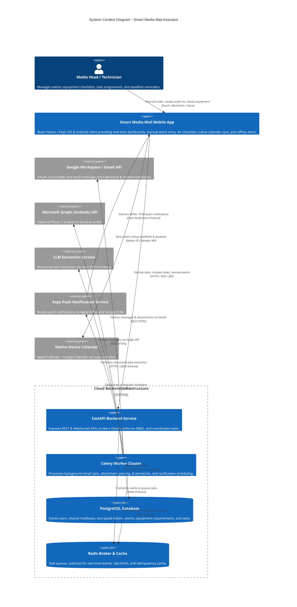
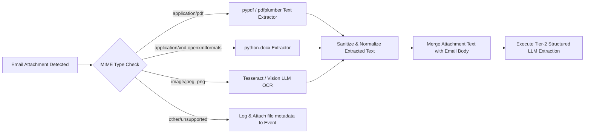
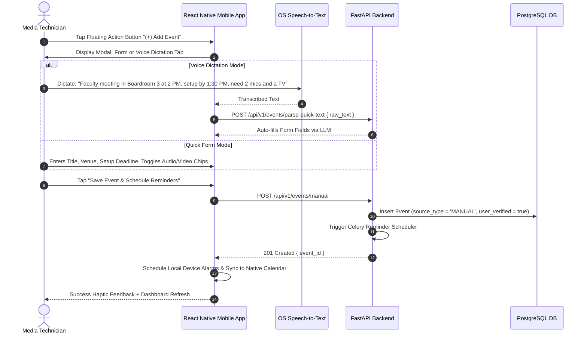
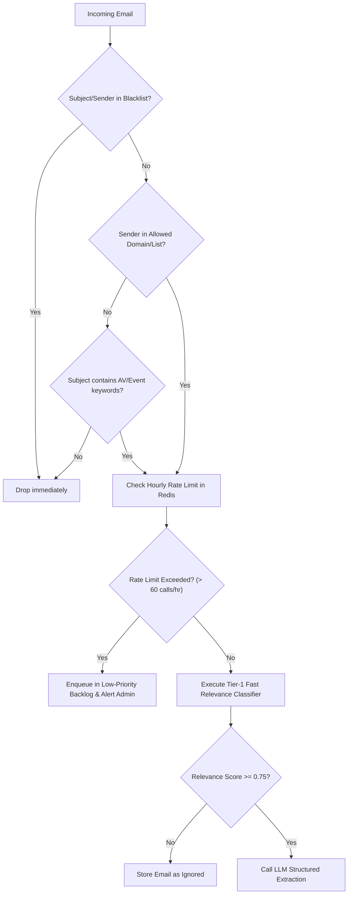
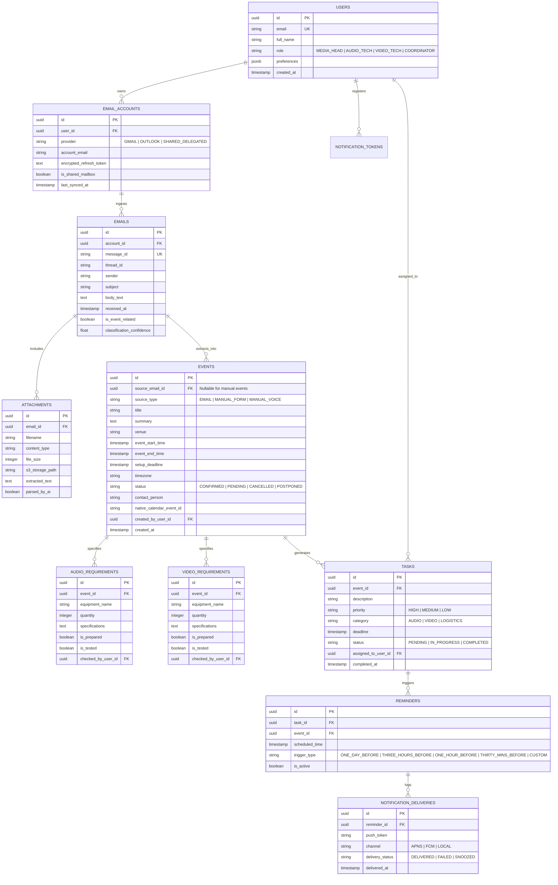

# System Architecture Document
## Smart Media Mail Assistant (Mobile & Backend Ecosystem)

**Document Version:** 1.1.0  
**Status:** Approved Architectural Blueprint  
**Target Platform:** Mobile (iOS & Android via React Native Expo) + High-Performance Backend (Python FastAPI)  
**Author / Team:** Advanced Mobile & AI Systems Engineering Team  

---

## 1. Executive Summary & Architecture Vision

The **Smart Media Mail Assistant** is an intelligent, mission-critical event operations platform engineered for media heads, audio engineers, video technicians, and event coordinators. Media production environments in institutions, universities, and performance venues operate under tight, zero-fail deadlines where missed equipment requests (e.g., microphones, digital audio consoles, stage monitors, LED screens, video switchers) cause catastrophic production failures.

To address the challenges documented in the Product Requirements Document (PRD) and incorporate practical operational realities (walk-in events, email attachments, shared department inboxes, and native calendar syncing), this architecture adopts a **Distributed Hybrid Architecture**:
- **Mobile Client:** A high-performance, cross-platform mobile application built with **React Native (Expo SDK 51/52, TypeScript)**, utilizing a **Feature-Driven Clean Architecture**, **TanStack Query (React Query v5)** for server state synchronization and optimistic UI updates, **Zustand** for transient UI state, **MMKV** for persistent offline caching, and **expo-calendar** for native device integration.
- **Dedicated Backend:** A production-grade **Python FastAPI** service providing asynchronous REST APIs, WebSocket real-time feeds, secure OAuth 2.0 PKCE orchestration, and cryptographic token management.
- **Asynchronous AI, Attachment & Worker Pipeline:** **Celery** backed by **Redis** for 24/7 background email synchronization (Gmail API / Microsoft Graph), multi-document attachment extraction (`pypdf`, `python-docx`, Tesseract/Vision OCR), multi-stage AI extraction, priority scoring, and scheduled notifications.
- **Hybrid Notification & Calendar Engine:** Server-initiated **Remote Push Notifications (Expo Push / APNs / FCM)** coupled with **Local Device Notifications (expo-notifications)** and **Device Calendar Alarms (expo-calendar)** for fail-safe, offline-resilient alerts in RF-shielded auditoriums.
- **Multi-Channel Ingestion:** Automated email scanning + **Manual Walk-In Event Creation** (quick form and voice-to-text dictation) for emergency hallway or phone requests.

---

## 2. High-Level System Architecture & Context

### 2.1 C4 Context Diagram



---

## 3. Email Ingestion Standards & AI Processing Pipeline

### 3.1 Recommended Email Format Template for Organizers
To achieve **99%+ automated extraction accuracy**, institutions can distribute this standardized template to academic departments, student bodies, and event coordinators:

```text
Subject: [EVENT REQUEST] - <Event Name> - <Date: YYYY-MM-DD>

Dear Media & Technical Services Team,

Please review the following event request and technical requirements:

1. EVENT DETAILS:
- Event Title: University Annual Convocation 2026
- Date of Event: 25 October 2026
- Event Timing: 10:00 AM – 1:00 PM
- Venue / Room: Main Auditorium (Stage A)
- Organizer / Department: Office of the Academic Registrar
- On-Site Contact Person: Dr. Robert Vance (Mobile: +1-555-0199)

2. SETUP DEADLINE:
- Required Setup Completion: 8:00 AM (2 hours prior for live mic checks)

3. AUDIO REQUIREMENTS:
- Wireless Handheld Microphones: 4
- Podium Gooseneck Microphone: 1
- Digital Mixing Console: 1 (with stage multi-core snake)
- Stage Monitors (Foldback): 2 wedges
- Audio Recording: Required (Direct USB stereo feed)

4. VIDEO & DISPLAY REQUIREMENTS:
- Center Stage Projector & Screen: 1 (1080p / HDMI input from podium)
- Stage Left/Right LED Confidence Monitors: 2
- Video Cameras for Archival Recording: 2 tripod mounts
- Live Video Streaming: Yes (to university YouTube channel)

5. SPECIAL NOTES / VIP ATTENDANCE:
- Chancellor and University Board in attendance; mandatory soundcheck at 8:30 AM.

Thank you,
Events Coordinating Committee
```

### 3.2 Real-World Conversational Email Example (Messy / Informal)
The AI engine is trained and prompted to accurately parse informal, conversational emails where details are scattered:

```text
Subject: Re: Next week's symposium tech setup

Hi Media Crew,

Just checking in regarding the International Bioethics Symposium next Tuesday (Nov 17th). 
We booked the Science Hall auditorium from 2 PM to 5 PM. 

Can we make sure we have at least 3 lapel mics for the panelists and one cordless mic 
for audience Q&A? Also, our keynote speaker wants to show high-res slides, so we will need 
the 4K laser projector and an audio feed from their MacBook for video playback. 

Dean Sarah wants everything tested and running no later than 12:30 PM because the guest 
speakers arrive early. 

Attached is the full speaker schedule in PDF. Let me know if you need anything else!

Best,
Elena Rostova
Program Coordinator
```

**AI Parsed Result:**
- **Event:** International Bioethics Symposium
- **Date & Time:** Nov 17, 2026 (14:00 - 17:00) | **Venue:** Science Hall auditorium
- **Setup Deadline:** Nov 17, 2026 at 12:30 PM (Flagged 90 mins prior)
- **Audio:** 3 Lapel Microphones, 1 Wireless Handheld Mic (Audience Q&A), 3.5mm/HDMI MacBook Audio Feed
- **Video:** 1 4K Laser Projector
- **Priority:** 🟡 **MEDIUM** (4 days lead time, VIP attendance flagged)

---

### 3.3 Attachment Ingestion Subsystem (PDF, DOCX, Image OCR)
When an email body contains brief text like *"Please see attached schedule and AV sheet"*, the Celery background worker executes the attachment processing pipeline:



### 3.4 Pydantic Extraction Schema (with Attachment & Source Tracking)

```python
from pydantic import BaseModel, Field
from typing import List, Optional
from datetime import datetime

class AudioRequirement(BaseModel):
    equipment_name: str = Field(description="Name of audio equipment")
    quantity: int = Field(default=1, description="Quantity requested")
    specifications: Optional[str] = Field(None, description="e.g. Lapel, Handheld, XLR, Podium")
    assigned_team: str = Field(default="AUDIO", description="Departmental routing")

class VideoRequirement(BaseModel):
    equipment_name: str = Field(description="Name of video equipment")
    quantity: int = Field(default=1, description="Quantity requested")
    specifications: Optional[str] = Field(None, description="e.g. HDMI, 4K, LED Wall, Live Stream")
    assigned_team: str = Field(default="VIDEO", description="Departmental routing")

class ExtractedEventData(BaseModel):
    is_event_request: bool = Field(description="True if contains institutional event or AV request")
    event_name: str = Field(description="Official name of the event")
    summary: str = Field(description="2-3 sentence executive summary")
    venue: Optional[str] = Field(None, description="Auditorium, Hall, or Room")
    event_start_datetime: Optional[datetime] = Field(None, description="Event start ISO-8601")
    event_end_datetime: Optional[datetime] = Field(None, description="Event end ISO-8601")
    setup_deadline: Optional[datetime] = Field(None, description="Setup deadline ISO-8601")
    contact_person: Optional[str] = Field(None, description="Organizer name and contact phone/email")
    audio_requirements: List[AudioRequirement] = Field(default_factory=list)
    video_requirements: List[VideoRequirement] = Field(default_factory=list)
    attachment_extracted_data: Optional[str] = Field(None, description="Highlights from attached PDF/docs")
    is_schedule_update: bool = Field(default=False, description="True if modifies an earlier event")
    confidence_score: float = Field(description="Confidence score 0.0 - 1.0")
```

---

## 4. Manual "Walk-In" Event Creation Architecture

In institutional environments, urgent requests arrive via phone, WhatsApp, or in-person walk-ins (*"Dean needs 2 mics in Hall B at 4 PM today"*). The mobile client and backend provide a dedicated fast-entry path:



---

## 5. Mobile Client Architecture (React Native & Expo)

### 5.1 Technology Foundation
- **Framework:** React Native 0.74+ with **Expo SDK 51/52** (Managed Workflow with Custom Config Plugins).
- **Navigation:** **Expo Router v3** (File-based, deeply typed routes with native modal sheets).
- **Calendar Integration:** `expo-calendar` for direct synchronization to Apple Calendar and Google Calendar.
- **Speech Recognition:** `expo-speech` and OS native dictation APIs for hands-free event entry on stage.
- **State & Caching:** **TanStack Query v5** (server cache & optimistic updates) + **Zustand** (UI state) + **react-native-mmkv** (offline cache).
- **Styling:** Vanilla StyleSheet + Design Token System (curated HSL palettes, dark/light modes, 60/120 FPS native performance).

### 5.2 Mobile Folder Structure (Feature-Driven Modular Architecture)

```text
media-app-mobile/
├── app/                                # Expo Router file-based route definitions
│   ├── (auth)/
│   │   ├── login.tsx                   # OAuth sign-in with Google / Microsoft
│   │   └── callback.tsx                # Deep link OAuth callback handler
│   ├── (tabs)/
│   │   ├── _layout.tsx                 # Bottom navigation tab bar definition
│   │   ├── index.tsx                   # Central Dashboard (Overview, Metrics, Filter by Audio/Video)
│   │   ├── events/
│   │   │   ├── index.tsx               # Upcoming events list & calendar view
│   │   │   └── [id].tsx                # Event details, AV checklists, sync calendar button
│   │   ├── tasks/
│   │   │   ├── index.tsx               # Task management, my-assignments toggle
│   │   │   └── [id].tsx                # Task detail & technician assignment
│   │   ├── emails/
│   │   │   ├── index.tsx               # Analyzed email summaries feed
│   │   │   └── [id].tsx                # Email summary, attachment viewer, source toggle
│   │   └── settings/
│   │       ├── index.tsx               # User preferences, mailboxes, reminder windows
│   │       └── mailboxes.tsx           # Connect shared department inboxes
│   ├── modal/
│   │   ├── add-manual-event.tsx        # Fast Manual Event & Voice Dictation Entry Modal
│   │   ├── filter.tsx                  # Advanced filter modal (Audio vs Video vs All)
│   │   └── conflict-resolver.tsx       # Schedule change confirmation modal
│   ├── _layout.tsx                     # Root application layout (Providers, Notifications)
│   └── +not-found.tsx
├── src/
│   ├── api/                            # Core networking, Axios/Ky client, interceptors
│   ├── components/                     # Shared Atomic UI components (Badges, Cards, Checklists)
│   ├── features/
│   │   ├── auth/                       # useAuth, SecureStore token management
│   │   ├── calendar-sync/              # hooks/useDeviceCalendarSync, services/calendarManager
│   │   ├── events/                     # useEventsQuery, manualEventMutation, EventCard
│   │   ├── technical-requirements/     # AudioChecklist, VideoChecklist, useChecklistToggle
│   │   ├── tasks/                      # useTasksQuery, useTaskAssignment
│   │   ├── emails/                     # useEmailSummaries, AttachmentViewer
│   │   └── notifications/              # usePushRegistration, useLocalNotifications
│   ├── store/                          # Zustand uiStore (active crew filter: ALL | AUDIO | VIDEO)
│   ├── theme/                          # Colors, Typography, Spacing tokens
│   └── utils/                          # Timezone converters, date formatters
├── app.json
└── tsconfig.json
```

---

## 6. Shared Department Mailbox & Team Assignment Subsystem

### 6.1 Shared Mailbox Delegation
Universities and organizations receive event requests via shared mailboxes (`media-support@university.edu`, `av-services@...`).
- The Media Head or Admin authorizes the shared mailbox once via Google Workspace Service Account delegation or Microsoft Graph application permissions.
- Ingestion runs continuously for the shared mailbox.
- All media crew members who sign in have visibility into the central department queue.

### 6.2 Role-Based Filtering & Task Assignments
Technicians can switch their app dashboard context with one tap:
- **"All Requirements"** (Media Head overview)
- **"Audio Crew View"** (Filtered strictly to wireless mics, mixers, monitors, XLR runs)
- **"Video Crew View"** (Filtered strictly to LED walls, projectors, cameras, switchers)
- **"My Assignments"** (Tasks explicitly assigned to the logged-in technician)

When the Media Head taps **"Assign to Technician"** $\rightarrow$ *Marcus (Audio)*, the backend dispatches a targeted push notification:
> 🔔 **New Assignment:** "Marcus, you are assigned to Audio Setup for University Annual Day (Setup by 3:00 PM today)."

---

## 7. Native Device Calendar Integration (`expo-calendar`)

Technicians frequently plan their schedules inside native calendar apps (Apple Calendar on iOS, Google Calendar on Android). The mobile app includes a seamless, bidirectional sync engine:

1. **Auto-Calendar Creation:** On first launch, the app creates a dedicated native calendar named **"Media Team Deadlines"** with a distinct brand color (Electric Violet `#6366F1`).
2. **Setup Deadline Event:** Creates a high-priority calendar block for the **Setup Window** (e.g. 1:00 PM – 3:00 PM) with 1-hour and 15-minute native OS alarms.
3. **Event Runtime Block:** Creates a second block representing the actual event duration.
4. **Deep-Link URL:** The native calendar entry includes a clickable deep link (`mediaapp://events/{event_id}`) that opens the app directly to the equipment checklist.
5. **Auto-Update on Reschedule:** If an event is postponed or cancelled via follow-up email, the app updates or deletes the native calendar entry automatically.

---

## 8. AI Cost Guardrails & Circuit Breaker Architecture

To prevent accidental API budget spikes from automated email loops, newsletters, or malicious spam storms:



---

## 9. Comprehensive Database Schema (PostgreSQL)



---

## 10. REST API & WebSocket Specifications

### 10.1 Key REST Endpoints

| Method | Endpoint | Description | Auth |
|---|---|---|---|
| `POST` | `/api/v1/auth/google/exchange` | Exchanges PKCE auth code for JWT session | No |
| `GET` | `/api/v1/events` | Lists events (filterable by `crew_type`: ALL, AUDIO, VIDEO) | Yes |
| `POST` | `/api/v1/events/manual` | Creates a manual walk-in or phone request event | Yes |
| `POST` | `/api/v1/events/parse-quick-text` | Takes raw voice dictation text and returns structured fields | Yes |
| `GET` | `/api/v1/events/{id}` | Returns event detail, AV checklists, and assigned crew | Yes |
| `PATCH` | `/api/v1/events/{id}/requirements/{req_id}` | Toggles equipment prepared/tested with audit user ID | Yes |
| `POST` | `/api/v1/events/{id}/sync-calendar` | Generates payload for device native calendar sync | Yes |
| `GET` | `/api/v1/tasks` | Lists tasks with status, priority, and assignment filters | Yes |
| `PATCH` | `/api/v1/tasks/{id}/assign` | Assigns a task to a technician & dispatches push notification | Yes |
| `GET` | `/api/v1/emails/analyzed` | Lists parsed emails with attachment extraction badges | Yes |
| `POST` | `/api/v1/notifications/register-token` | Registers Expo Push token for iOS / Android device | Yes |

---

## 11. Architecture Decision Records (ADRs) Summary

| Decision ID | Context / Question | Selected Alternative | Architectural Rationale |
|---|---|---|---|
| **ADR-01** | Mobile Framework | **React Native + Expo (TypeScript)** | Single cross-platform codebase, native 60/120 FPS UI, robust push notifications and EAS update support. |
| **ADR-02** | Backend & Processing | **FastAPI + Celery + PostgreSQL** | Guarantees continuous 24/7 email monitoring, document parsing, and reminder execution independent of phone state. |
| **ADR-03** | State Management | **TanStack Query v5 + Zustand + MMKV** | Decouples server state from UI state; MMKV guarantees $< 15\text{ms}$ cold-start hydration when offline. |
| **ADR-04** | Ingestion Channels | **Dual (Automated Email + Manual Walk-in)** | Captures both structured email requests and emergency hallway/phone walk-in requests via voice or quick form. |
| **ADR-05** | Attachment Parsing | **Asynchronous Celery Pipeline (`pypdf`, OCR)** | Extracts crucial run-of-show sheets and tech specs from attached PDFs/Word docs when the email body is brief. |
| **ADR-06** | Notification Strategy | **Hybrid Remote Push + Local Device Alarms** | Remote alerts handle server updates; local `expo-notifications` guarantee alarms ring inside RF-shielded auditoriums. |
| **ADR-07** | Calendar Integration | **Native OS Sync via `expo-calendar`** | Places setup deadlines directly on technicians' native Apple/Google Calendar widgets with deep links to checklists. |
| **ADR-08** | Ingestion Safety | **Redis Token Bucket Rate Limiting** | Protects external LLM APIs from bill shocks during email reply loops or departmental newsletter blasts. |

---

*This document serves as the formal architectural reference for all implementation phases of the Smart Media Mail Assistant.*
